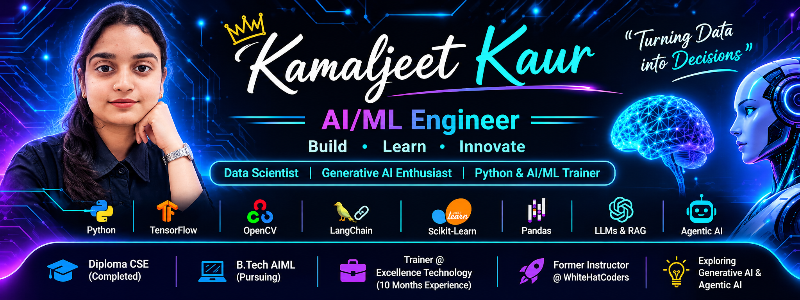

# 👋 Hi, I'm Kamaljeet Kaur

### AI/ML Developer | Generative AI Enthusiast | Python & AI/ML Trainer

Building practical applications with Python, machine learning and generative AI.

---

## About Me

I'm an aspiring AI/ML Engineer and Generative AI Developer interested in building useful, real-world applications and turning data into meaningful insights.

- 🎓 Diploma in Computer Science & Engineering — Completed
- 🎓 B.Tech in Artificial Intelligence & Machine Learning — Pursuing
- 👩‍💻 Python & AI/ML Trainer at **Excellence Technology**
- 💼 Professional training experience at Excellence Technology — January 2026 to present
- 🏢 Former Python AI Intern at Extech Digital
- 👩‍🏫 Former Instructor at WhiteHatCoders — 3 months
- 🤖 Exploring Generative AI, LLM applications, RAG and Agentic AI
- 🔨 I learn, build and teach through practical implementation

> Turning data into decisions, and ideas into intelligent solutions.

## Professional Experience

| Organization | Role | Period |
|---|---|---|
| Excellence Technology | Python & AI/ML Trainer | January 2026 – Present |
| Extech Digital | Python AI Intern | Internship |
| WhiteHatCoders | Instructor | 3 months |

At Excellence Technology, my work includes teaching Python, Data Science, AI/ML and Generative AI; preparing practical assignments; and guiding learners through hands-on projects.

## Education

| Qualification | Specialization | Status |
|---|---|---|
| Diploma | Computer Science & Engineering | Completed |
| B.Tech | Artificial Intelligence & Machine Learning | Pursuing |
| Class 12 | Vocational – Electronics | 96% |
| Class 10 | General Education | 97% |

## Technical Skills

**Programming & databases**

**AI, machine learning & data science**

**Generative AI & application development**

**Analytics & tools**

## Featured Projects

### ❤️ Heart Disease Predictor
An ML application that estimates heart-disease risk from input health parameters.
- **Stack:** Python, Pandas, Scikit-learn
- **Repository:** [View source code](https://github.com/kamal1913jeet/heart-disease-predictor)

### 🎬 Movie Recommender System
A content-based movie recommendation application using cosine similarity and TMDB API integration.
- **Stack:** Python, NLP, Streamlit, TMDB API
- **Repository:** [View source code](https://github.com/kamal1913jeet/movies-recommender-system)

### 💬 WhatsApp Chat Analyzer
Analyzes exported chat data to produce message trends, activity summaries, emoji statistics and visualizations.
- **Stack:** Python, Pandas, Matplotlib, Seaborn, Streamlit
- **Repository:** [View source code](https://github.com/kamal1913jeet/Whatsapp-Chat-Analyzer)

### 🏦 Bank Management System
A banking application covering account creation, savings/current accounts, transactions and account statements.
- **Stack:** Python, Streamlit, MySQL
- **Repository:** [View GitHub projects](https://github.com/kamal1913jeet)

## Certifications & Achievements

I keep this section limited to verifiable credentials. Add each certificate with its exact title, issuing organization, completion date and (if public) credential URL.

<!-- Add verified certificates here. Example:
- [Certificate title](credential-url) — Issuing organization, Month Year
-->

## Project Demos & Screenshots

Project source-code links are included above. Live demo links and application screenshots can be added after the apps are deployed and the screenshots are uploaded to this repository. This avoids showing broken images or demo links that do not work.

Suggested image paths once you upload screenshots:
- `assets/heart-disease-predictor.png`
- `assets/movie-recommender.png`
- `assets/whatsapp-chat-analyzer.png`
- `assets/bank-management-system.png`

## Currently Exploring

- Advanced Retrieval-Augmented Generation (RAG)
- LLM-powered applications and prompt engineering
- AI agents and agentic workflows
- Embeddings and vector databases
- Transformers and practical GenAI systems

## GitHub Analytics

## Let's Connect

- **LinkedIn:** [Kamaljeet Kaur](https://linkedin.com/in/kamaljeet-kaur-5a09983ba/)
- **Email:** [kamal1913jeet@gmail.com](mailto:kamal1913jeet@gmail.com)
- **GitHub:** [kamal1913jeet](https://github.com/kamal1913jeet)
- **Kaggle:** [kamal1913jeet](https://kaggle.com/kamal1913jeet)
- **Hugging Face:** [kamal1913jeet](https://huggingface.co/kamal1913jeet)

---

*Learning • Building • Teaching • Innovating*
